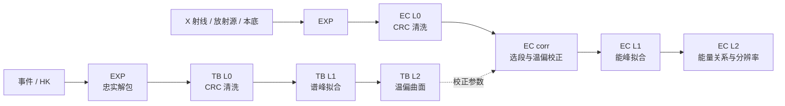

<p align="center">
  
</p>

<h1 align="center">GRID Calibration Lab</h1>

<p align="center">天格探测器地面标定与交互复核</p>

<p align="center">
  <a href="https://www.python.org/"></a>
  <a href="workbench/README.md"></a>
</p>

<p align="center">
  <a href="https://github.com/Lee-Eee-Eee/GRID_Calibration_Lab/wiki">使用教程 Wiki</a> ·
  <a href="#快速开始">快速开始</a> ·
  <a href="#工作台">工作台</a> ·
  <a href="#处理流程">处理流程</a> ·
  <a href="#脚本与批处理">脚本与批处理</a> ·
  <a href="#更多文档">更多文档</a>
</p>

从原始事件和遥测数据生成温度—偏压校正与能量标定参数。把分层计算、三维曲面、原谱和拟合窗口放在同一工作台中：发现异常点后，可以直接查看原谱、调整窗口、局部重算，再比较结果。

成员使用请从 [Wiki 教程](https://github.com/Lee-Eee-Eee/GRID_Calibration_Lab/wiki)开始：服务器安装与 SSH 转发、数据与预设、TB / EC 逐层操作、多峰配置、结果保存和问题处理。教程正文也随代码保存在 [docs/wiki](docs/wiki/README.md)。

14B / 15B 已接入 `cali_proc 0.5` 的文件表和四份分析配置。服务器计算与本地界面转发见 [GRID 部署](docs/server_workbench.md)，真实数据验证见 [适配验收](docs/contract_migration_validation.md)。

15B Co60 的 1173.228 / 1332.492 keV 双峰已在开发工作区保存为配置 v2，原版保留比较；[双峰复核](docs/co60_doublet_validation.md)记录谱拟合和 EC 残差。新成员按 [EC 教程](https://github.com/Lee-Eee-Eee/GRID_Calibration_Lab/wiki/EC-Calibration#15b-co60-联合双峰)建立自己的双峰预设版本。服务器数据目录可直接关联个人任务、配置版本和产品索引。


<p align="center"><sub>TB L2 三维曲面、工况能谱与残差联动 · 14B 交互演示</sub></p>

## 工作台

| 要做的事 | 在工作台中完成 |
| --- | --- |
| 读取不同载荷的数据 | 配置事件与 HK XML、字段换算、文件配对和工况来源，保存为载荷预设。 |
| 接入已有处理结果 | 每层选择共享产品、本任务上游或其他任务的结果；也可直接采用已有本层结果。 |
| 找到需要复核的谱 | 从工况列表或质量地图选择通道，查看能谱、候选峰、拟合曲线、参数误差和残差。 |
| 修改某一个结果 | 拖动拟合窗或输入 ADC 边界，重拟合当前通道；屏蔽、恢复点后更新曲面或能量关系。 |
| 处理一张多峰源谱 | 为每条能线、每个通道设置独立窗口和中心锚，拟合当前峰或当前通道的全部能线。 |
| 保存并继续处理 | 每份任务保存读取配置、TB 依赖、窗口、修订、结果和作业日志，重开后恢复。 |

<details>
<summary><strong>能谱复核：质量地图、工况列表与拟合窗口</strong></summary>


选择工况后，在同一页检查原谱与残差，调整窗口并重拟合。

</details>

<details>
<summary><strong>EC 多峰：能线配置与 Co60 谱拟合</strong></summary>


同一源谱的能线分别配置，各通道保留独立窗口与结果。

</details>

## 快速开始

**成员在服务器使用：** 按 [安装与连接](https://github.com/Lee-Eee-Eee/GRID_Calibration_Lab/wiki/Server-Setup)在个人目录安装，关联共享数据并启动服务，再通过 SSH 转发在自己的浏览器操作。

**在本机开发或独立使用：**

需要 Python 3.10 及以上和 [uv](https://docs.astral.sh/uv/getting-started/installation/)。下面使用 Python 3.11；Node.js 只用于前端测试。

```powershell
git clone --branch feat/calibration-workbench https://github.com/Lee-Eee-Eee/GRID_Calibration_Lab.git calibration_lib
cd calibration_lib
uv sync --python 3.11 --extra workbench
New-Item -ItemType Directory -Force ../grid-workspace | Out-Null
uv run --extra workbench grid-workbench --workspace ../grid-workspace --port 8765
```

打开 **http://127.0.0.1:8765/**，选择数据和产品目录、载荷读取预设，再创建任务。已有原始数据或分层产品都可以作为入口。新结果写入工作区的 `runs/`，图表资源随应用在本机加载。

macOS / Linux 使用 `mkdir -p ../grid-workspace` 创建工作区，其余命令相同。

<details>
<summary>使用 pip 安装（Windows）</summary>

在克隆后的仓库目录运行：

```powershell
python -m venv .venv
.venv/Scripts/python.exe -m pip install ".[workbench]"
New-Item -ItemType Directory -Force ../grid-workspace | Out-Null
.venv/Scripts/grid-workbench.exe --workspace ../grid-workspace --port 8765
```

</details>

## 处理流程

**TB 标定**固定入射能量，测量同一能峰在不同温度、偏压下的位置，拟合增益曲面。**EC 标定**使用 TB 参数校正温偏，再从已知能线建立 ADC 与能量的关系。



各层分别保存 Parquet、JSON、拟合图和运行清单。工作台直接调用库内处理器，支持逐层执行和局部重算。目录、模型及输出约定见 [处理与数据指南](docs/processing.md)。

## 脚本与批处理

命令行入口 `grid-calib` 保留旧版七层配置；新版 14B / 15B 通过工作台加载确认文件表及分析预设，使用相同库内处理器。原始数据路径和 CLI 参数见 [处理指南](docs/processing.md#命令行运行)。

```bash
uv run grid-calib 15B TB_L1 --products ../products
uv run grid-calib 15B TB_L1 --products ../products --only m20C-287-106
uv run grid-calib 15B TB_L2 --products ../products
```

也可以在 Python 中调用整条流程：

```python
from pathlib import Path
from calibration_lib.pipeline import CalibrationPipeline

pipeline = CalibrationPipeline("14B", Path("../products"))
pipeline.run_tb()
pipeline.run_ec()
```

## 更多文档

| 文档 | 内容 |
| --- | --- |
| [成员使用 Wiki](https://github.com/Lee-Eee-Eee/GRID_Calibration_Lab/wiki) | 从服务器安装到 TB / EC 标定、预设、多峰和结果复核的完整教程。 |
| [工作台使用](workbench/README.md) | 数据目录、载荷预设、TB 依赖、任务、运行和结果复核。 |
| [L1 谱复核](docs/l1_workbench.md) | 工况与通道切换、拟合窗口、残差和局部重算。 |
| [分层输入与局部更新](docs/layer_inputs.md) | 输入来源、已有结果复用、固定依赖和配置变化后的重算范围。 |
| [处理与数据指南](docs/processing.md) | TB / EC 分层、命令行、Python API、产物与曲面模型。 |
| [新数据规范对照](docs/cali_proc_format_20261102.md) | cali_proc 的 EXP / L0–L2 契约、载荷差异及本库适配位置。 |
| [服务器部署](docs/server_workbench.md) | 数据留在 GRID，通过 SSH 转发在本地操作。 |
| [新规范适配验收](docs/contract_migration_validation.md) | 时间、曝光、物理通道、产物与真实回归。 |
| [寻峰与质量诊断](docs/peak_finding.md) | 候选峰、背景模型、计数误差、选窗和疑似问题提示。 |
| [读取协议](docs/packet_protocols.md) | XML、事件与 HK 包、字段和 CRC。 |
| [原始谱读取复测](docs/readout_crc_validation.md) | 14B / 15B 读取配置、CRC 与谱尾问题。 |
| [N5 预设](docs/n5_preset.md) | N5 数据入口、工况识别和本底配对进展。 |

### 当前适用范围

14B / 15B 新预设按规范执行分段 ODR `E=f(ADC)` 及分辨率拟合；既有任务保持自己的配置。10B、11B 和 N5 使用各自预设；10B / 11B 的塑料 CH3 保留模型待定状态，N5 的 EC 跨照射本底仍待接入。

拟合质量以疑似问题提示呈现。数值有效的结果可以继续参与下游计算，手动屏蔽、数值失败和模型待定分别处理。

### 开发检查

```bash
uv sync --extra workbench --extra dev
uv run --extra workbench --extra dev pytest tests -q
node --test tests/frontend/*.test.cjs
```

问题和改进建议可通过 [Issues](https://github.com/Lee-Eee-Eee/GRID_Calibration_Lab/issues) 反馈。
