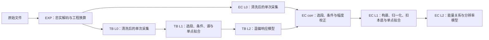

# cali_proc 新数据规范与本库适配对照

整理日期：2026-11-02。参考仓库为 [wqd23/cali_proc][repo]，读取的 `main` 提交为 [`0d1f620f2573653f36211721aa13e88f0d35fbab`][commit]，代码版本 `0.5.0`；共同规范更新于 2026-11-01。本库对照基线为 `5d79dfa0b9c62750d4eed8a4360fbb2f4c21c4d0`。

当前层级和最小文件契约以 [工作流层级划分][workflow] 为入口，字段细节结合对应载荷的代码、YAML 和文件表读取。下文分别列出共同要求、14B/15B 的具体实现和已发现的文档差异。本次整理未改变处理器或已有结果。

## 1. 层级重新划分



| 现有 calibration_lib | 新规范中的对应职责 | 变化 |
| --- | --- | --- |
| TB L0 解包、保存 HK 统计 | EXP + TB L0，以及一部分 TB L1 | 解码、清洗和分析统计分开 |
| TB L1 谱峰拟合 | TB L1 | 同时保存谱、条件、选段和拟合证据 |
| TB L2 曲面 | TB L2 | 模型进入时间戳目录，配独立 Meta |
| EC L0 解包、逐事件写入 temp/bias | EXP + EC L0，以及一部分 corr | L0 保存完整采集，不提前指定最终温偏条件 |
| EC L1 温偏校正 | corr | corr 是处理步骤，可在内存完成，无必需独立目录 |
| EC L2 单谱能峰拟合 | EC L1 | 单点、谱和分析证据组成一个分析目录 |
| EC L3 能量关系与分辨率 | EC L2 | 独立通道模型、真实分段和新的统计口径 |

新规范的 EC 到 L2。现有工作台仍按原七层运行；以上是适配映射，尚未切换层号。

## 2. 目录与文件

新参考仓库的默认目录为：

```text
data/<payload>/
├── EXP/<group>/<acquisition-id>/
│   ├── meta.json
│   ├── events.parquet
│   ├── telemetry.parquet
│   └── issues.parquet
├── tb/
│   ├── L0/<observation-id>/
│   │   ├── meta.json
│   │   ├── events.parquet
│   │   └── hk.parquet
│   ├── L1/<measurement-id>/
│   │   ├── meta.json
│   │   ├── points.json
│   │   ├── spectra.parquet
│   │   ├── fit.png
│   │   └── selection.png
│   └── L2/<YYMMDDHHMM>/
│       ├── <YYMMDDHHMM>_temp_bias_fit.json
│       ├── <YYMMDDHHMM>_temp_bias_fit.meta.json
│       └── 拟合图
└── ec/
    ├── L0/<observation-id>/        # 同样保存 meta/events/hk
    ├── L1/<analysis-id>/
    │   ├── meta.json
    │   ├── points.json
    │   ├── spectra.parquet
    │   ├── fit.png
    │   └── selection*.png
    └── L2/<YYMMDDHHMM>/
        ├── <YYMMDDHHMM>_ec_fit.meta.json
        ├── <YYMMDDHHMM>_ec_coef_sci_ch<N>.json
        └── 能量关系与分辨率拟合图
```

EXP/L0 的表名和附加表按载荷确定；上图列出 14B/15B 实现。03B 还保存 `timeline.parquet`、`udp.parquet`、`sciconfig.json`。GRIDN1 共用 `tb/L0/`，两套 TB 分别位于 `tb/Am241/{L1,L2}/` 和 `tb/Na22-511/{L1,L2}/`。[共同目录契约][workflow]、[14B EXP][exp14]、[03B EXP][exp03]

本库适配时可以将这个载荷内布局放在 `runs/<run_id>/products/` 下，继续使用现有试算根目录。来源采集、分析和模型版本应分别有身份；同一采集可以供多个选段或能线分析引用。

## 3. 各层保存什么

### EXP：完整解码事实

- 保存可解码的好、坏 CRC 记录及校验标记；残包、未识别字节和非法记录写入诊断。
- 保留原生编码、工程量、原始计数、文件内行身份、包序和字节位置。
- 来源文件、SCI/HK 配对、转换规则和时钟声明写入 Meta。
- 稳定平台、峰窗、分析角色和最终曝光由后续分析确定。

### L0：工作流稳定输入

- 清除坏 CRC、非法通道、非有限必要幅值等明确错误，记录规则及逐原因数量。
- 保存后续选段、条件计算和时间归一化所需的事件/HK；保留原生行序和 `source_idx`。
- 保留实际采集的通道。10B/11B 分析只用 CH0–2，L0 仍保存 CH3。
- 14B/15B 的有限负幅值仍留在 L0；是否选用由分析阶段决定。
- L0 不要求已经是连续稳定段。一个无效 HK 样本也不自动对应一批应删除的 SCI 事件。

### L0→L1：分析定义生效

选择 SCI/HK、计算实测温偏及标准差、确定曝光、进行 corr、构谱并拟合。主测量和本底分别完成这些步骤，随后按同单位的归一化依据相减。时间缺口、分段和采用均值近似的理由进入 L1 证据。[职责与时间要求][workflow]

## 4. 14B/15B 的表结构与单位

两颗载荷的 EXP schema 为 `exp-engineering@2`；L0 分别为 `g14b-l0@1`、`g15b-l0@1`。L1/L2 则按载荷和流程命名，如 `g14b-tb-l1@1`、`g14b-ec-l2@1`。这些标识需要与具体字段契约一起判断，不能只看层号。[EXP/L0 定义][exp14]、[L0 实现][l014]

| 表 | 主要字段 | 含义 |
| --- | --- | --- |
| events | `channel`、`event_number`、`pkg_event_num` | 物理通道及设备序号 |
| events | `timestamp1`、`timestamp2`、`utc`、`pps_for_utc`、`timestamp_for_pps` | 原生时间信息；不能互相替代 |
| events | `data_max`、`data_base`、`data_sum`、`data_ccm`、`amp` | 原始脉冲量；`amp=data_max-data_base/4`，单位 ADC |
| events / HK | `source_idx`、`packet_idx`、`packet_byte_offset`、`raw_crc`、`crc_check` | 来源位置与校验 |
| HK | `utc_time`、`raw_{bias,imon,temp}_chN` | 原生遥测时间与四通道原始码 |
| HK | `sipm_temp_chN`、`sipm_current_uA_chN`、`bias_chN` | °C、μA、V；14B/15B 温度为 `raw_temp/100-273.15`，偏压为 `raw_bias/1000` |
| issues | `kind`、`table`、`decoded_offset`、`source_offset`、`bytes`、`expected_bytes`、`token`、`evidence` | 解码异常及定位信息 |

14B/15B 的 FT584 包仍是 **38 个事件、14 字节步长**，与本库修正后的读取方式一致。

### 时间与 corr

`timestamp1` 是已确认 **100 MHz** 的包级 SCI 计数；`timestamp2` 频率未确认。HK `utc_time` 与 SCI 没有已验证公共时间轴，不能按数值接近或行进度进行逐事件时间插值。

当前 14B/15B 分析采用：

- TB：选择 HK 偏压平台并统计实际温偏；SCI 保留该次采集，曝光记录整采集计数跨度。
- EC：每个角色、每个物理通道使用自己的 HK 平台均值，经对应通道 TB 模型校正到 **25 °C / 28.5 V**。保留 `amp`，增加 `amp_corr`。
- EC 曝光：按该角色、该物理通道所选事件的 `timestamp1` 首末差除以 100 MHz。原生行序倒退或内部间隔超过 10 s 时，这个曝光估计不可直接使用。

这里的曝光是采集跨度，未包含死时间修正。拟合质量提示与时间依据是否可用是两个不同判断。[14B 数据说明][data14]、[14B 观测实现][obs14]、[15B EC 实现][ecl115]

## 5. L1：单点、全谱和分析证据

### points.json

顶层按通道字符串键组织，如 `"0"`、`"1"`。每次分析对应已确认的谱特征；多能线可以分别建立分析记录并复用同一 L0。

| 类别 | 核心字段 | 单位 / 语义 |
| --- | --- | --- |
| 谱特征 | `window`、`center`、`center_std`、`sigma`、`sigma_std` | ADC；`*_std` 是标准不确定度 |
| 拟合诊断 | `background`、`background_params`、`redchi`、`ndf`、`n_bins`、`boundary_hits` | 模型、约化 χ²、自由度及边界 |
| 分辨率 | `resolution`、`resolution_std` | `R=2√(2ln2)·sigma/center`，小数值；界面百分数需乘 100 |
| 参数协方差 | `center_sigma_covariance` | center 与 sigma 的协方差，单位 ADC² |
| 幅度 | `amplitude`、`amplitude_std` | 14B/15B 当前保存高斯**峰高**及误差，不能当峰面积 |
| 实测条件 | `temperature_C`、`temperature_std_C`、`bias_V`、`bias_std_V`，以及按流程/载荷提供的 `hk_samples` | 温度、偏压和 HK 样本依据；15B EC 点中没有同名 hk_samples 字段 |
| TB | `n_events`、`exposure_s`、`exposure_basis` | 计数与时长依据 |
| EC | `energy_keV`、`primary_events`、`background_events` | 固定能量锚点与角色事件数 |
| EC 曝光 | `primary_exposure_s`、`background_exposure_s`，或对应 `*_ticks`、`exposure_unit` | 未确认秒数时秒字段为 null；保留实际原生值和单位 |
| 状态 | `status`、`reason`，及适用的 QA 字段 | 已拟合、未确认窗口、质量提示等 |

无确认峰窗时保存全域谱和实测条件，`window/center/center_std/sigma/sigma_std/redchi` 为 null，记录 `reason=no_confirmed_window`。14B/15B 实际使用 `status=unconfirmed`；不能把空值改成 0，也不能默认用全域窗口拟合。[TB L1 实现][tbl114]、[EC L1 实现][ecl114]

### spectra.parquet 与 bin 宽

| 流程 | 14B/15B 实际列 | 数量及单位 |
| --- | --- | --- |
| TB | `channel,x,bin_left,bin_right,counts,err,density,density_err` | `counts/err` 为每 bin 计数/误差；`density=counts/ΔADC`，单位 Counts/ADC |
| EC | `channel,x,bin_left,bin_right,net_rate,err,density,density_err,primary_rate,background_rate` | rate 列为每 bin 每秒；density 再除 bin 宽，单位 Counts/(s·ADC) |

14B/15B 当前 **TB 和 EC 均配置 4 ADC/bin**。这是这两颗载荷的配置值；例如 05B 的 TB 为 6、EC 为 10，不能设为所有载荷统一常数。

14B/15B 当前拟合的是 bin 中心处的 density。单角色计数误差为分段 Gehrels 近似：`N≥5` 时 `√N`，否则 `1+√(N+0.75)`。EC 两角色误差分别除以各自曝光，再平方相加；density 误差继续除以 bin 宽。`scale_covar=False`，不再按拟合残差缩放协方差。[构谱与拟合实现][obs14]、[14B TB 配置][tbcfg14]、[15B EC 配置][eccfg15]

以秒归一时，净密度为：

```text
D_net = N_primary / (t_primary · ΔADC) − N_background / (t_background · ΔADC)
σ²(D_net) = [σ(N_primary)/(t_primary · ΔADC)]²
            + [σ(N_background)/(t_background · ΔADC)]²
```

未知秒数的载荷使用已声明的原生曝光单位。12B 为 HK tick；13B 按角色对选择秒或 HK tick，同一对保持单位一致；GRIDN1 为 native UTC tick。绘图纵轴必须随实际列和 Meta 改变。[12B EC][ecl112]、[13B EC][ecl113]、[GRIDN1][datan1]

### meta.json

保存 L0 来源、选择历史、实际时间依据、条件、拟合配置、角色配对和归一化依据。EC 另外保存所用 TB 模型路径、SHA-256、各通道模型、参考条件和映射方法。模型绑定应随分析目录一起读取。

## 6. L2：模型结构和统计口径

### TB L2

五参数模型保持不变：

```text
G(T,V) = G0 · (V − kT − V0)² · (−T² + bT + c)
```

14B/15B 的模型 JSON 为四通道列表；每项包括 `channel,G0,k,V0,b,c`、各参数 `*_err`，以及 `ndf,redchi,points`。采用 `1/center_std` 加权、`lmfit`、`scale_covar=False`。Meta 保存输入单点、选点与排除、配置、通道槽位及模型哈希。[TB L2 实现][tbl214]

### EC L2

每个通道的 JSON 包含：

```text
channel
EC_low, EC_low_err, EC_high, EC_high_err
resolution_low, resolution_low_err, resolution_high, resolution_high_err
```

系数顺序和模型方向为：

```text
EC_* = [a,b,c]          E = a·ADC² + b·ADC + c
resolution_* = [a,b,c] R(E) = √(a·E² + b·E + c) / E
```

能量刻度使用 **固定能量锚点、ADC 测量误差的 ODR**，输出仍为 `E=f(ADC)`；实现中 `np.polyfit` 用于初值。分辨率直接拟合 R，以 `1/resolution_std` 加权，其误差包含 center–sigma 协方差。能量刻度的系数、完整协方差及 ADC 调整量等证据进入 Meta；分辨率模型当前导出系数误差。[EC L2 实现][ecl214]

14B/15B 当前低段为 **E<51 keV**，高段为 **E≥55 keV**，中间测量保留 L1，不加入两段模型；每段至少 4 个点。其他载荷依各自配置，不能复用一个全局分段值。

当前本库 EC L3 已使用 `E=f(ADC)`；需要改的是全能区拟合后复制低/高段系数的行为、权重与模型打包。旧 wiki 的 `ADC=f(E)` 不应继续当这版新规范的方向要求。

## 7. 采集配置、源能线和载荷差异

配置集中在 `src/calibration_process/configs/<payload>/`：普通载荷使用 `tb_l1.yaml,tb_l2.yaml,ec_l1.yaml,ec_l2.yaml`，GRIDN1 的两套 TB 分开命名。文件表与 YAML 显式记录 SCI/HK 配对、分析角色、能量、窗口、选段和模型选择。

| 文件表 | 当前格式 |
| --- | --- |
| 03B/05B `exp_files.txt` | 每行 SCI 相对路径，按已确认命名约定找到配套 HK/TimeLine/配置文件 |
| 04/07/09 `exp_files.txt` | 每行一个混合 SCI/HK 的采集文件 |
| 14B `exp_files.csv` | `id,sci,hk,group,accept_residual` |
| 15B `exp_files.csv` | `id,sci,hk,group` |

14B/15B X 光机按 `[ch1,ch2,ch3,ch0]` 轮换本底：目标 CH0 用 ch1 采集文件内的**物理 CH0**，目标 CH1 用 ch2 文件内的物理 CH1，依此类推。文件名中的照射槽位与事件的 `channel` 必须分别记录。

14B/15B 当前参考配置的三个源锚点为 Na22 511.004、Cs137 661.657、Co60 1332.492 keV。Co60 的 1173 keV 成分在该基准中用高斯背景处理；新配置 `background: gaus` 表示目标高斯加高斯背景，与本库 `gaus` 表示纯高斯的枚举含义不同。适配应翻译模型定义，保留工作台为同一谱增添多能线的能力。[14B EC 配置][eccfg14]

| 载荷 | 幅值规则 | 时间与条件映射 | 特殊处理 |
| --- | --- | --- | --- |
| 03B | max−base，14 位 | SCI 100 MHz / HK 1 MHz 独立；平台均值 | 四兄弟文件；TimeLine 已解码，尚未证明 SCI/HK 对齐 |
| 04 | amp=raw_amp，不减基线 | 共享 24.05 MHz；逐事件条件 | 平台分块、HK 覆盖及相应曝光区间 |
| 05B | max−base，16 位 | SCI 100 MHz / HK 1 MHz 独立；EC 整 HK 均值 | X 主测量与本底取同一采集的不同 SCI 时间窗 |
| 07 | amp=raw_amp，不减基线 | 共享 24.05 MHz；逐事件条件 | HK 覆盖缺口从曝光中扣除 |
| 09 | amp=raw_amp，不减基线 | 共享 20 MHz；默认逐事件 | 45 keV 用均值；重启文件按原 source_idx 选片段 |
| 10B | max−base/4 | SCI 100 MHz / HK 1 Hz，独立；角色均值 | L0 四通道，分析 CH0–2 |
| 11B | max−base/4 | 100 MHz SCI；粗 UTC 选 HK，角色均值 | CH0–2；四个源不扣独立本底 |
| 12B | max−base/4 | 32 位 100 MHz SCI 重建；无公共轴 | EC 当前统一 HK tick；秒字段 null |
| 13B | max−base/4 | 32 位 100 MHz SCI 重建；无公共轴 | 每角色对决定秒 / HK tick，通道间单位可不同 |
| 14B | max−base/4 | 包级 timestamp1 100 MHz；角色平台均值 | 17 个 X 能点；部分用 vendor `.cut`；70 keV 缺完整轮换组合 |
| 15B | max−base/4 | 包级 timestamp1 100 MHz；角色平台均值 | 11 个 `X_new` 能点；旧 `X/` 不进入当前基准 |
| GRIDN1 | max−base/4 | 原生 UTC tick；角色均值 | CH0/3 CLYC、CH1/2 GAGG；双 TB；源不扣独立本底 |

详见 [载荷数据索引][payloads]。GRIDN1 当前规范覆盖常规伽马标定，未将中子和 Na22-1274 provisional 标定纳入现行链路；本工作区的 N5 名称与 GRIDN1 的对应关系仍需按采集来源核对。

## 8. 本库需要适配的具体位置

下表是对 `5d79dfa` 的代码审查结论。仅移动文件或重命名字段不足以得到符合新契约的计算结果。

| 顺序 | 当前实现与差异 | 适配内容 |
| --- | --- | --- |
| 1 | `common/legacy_parser.py:89–96,307–393`：缺时间回退行号；默认末 60 个 HK；EC 按双方行进度插值 | EXP 保存完整原生 SCI/HK、源身份和时钟；L0 清洗；L1 显式选择平台。14B/15B 使用角色平台均值 |
| 2 | `ec/processors/L2_processor.py:195–217,660–721`：按文件槽聚合整表，并按谱形选择其他文件作本底 | 分离 acquisition-id、照射槽位、物理 channel，按确认配对及同物理通道读取 |
| 3 | 同文件 `:621–638`：当前时间列首尾跨度，非正时回退 1 秒；rate 未除 bin 宽 | 按载荷计数证据计算曝光，保存单位；同时输出每 bin 数据和 density，传播对应误差 |
| 4 | `common/utils.py:135–232` 与各层 writer：按类型集中放 parquet/json/figures；单点为列表 | 新增分析目录读写，保存 points/spectra/meta/selection；旧格式通过兼容读取 |
| 5 | `ec/processors/L3_processor.py:162–180,416–425`：全能段二次拟合再复制到 low/high；ADC 误差用作能量纵轴权重 | 独立分段、固定能量的 ODR；核对 R 系数顺序、协方差和参数单位 |
| 6 | `ec/processors/L1_processor.py:155–173`、`workbench/service.py:1265,1619–1663`：TB 绑定信息分布在 Parquet 和工作台状态 | 将完整通道模型、包路径/hash、参考条件和映射证据写入可独立读取的分析 Meta |
| 7 | `workbench/service.py:1702–1735`：实际使用外层旧 cali_format 检查器；库内 checks 又存在更旧字段 | 按新 schema 和目录契约增加检查及导入，区分新旧格式；调整工作台的层级映射 |

其他字段转换要点：旧 `center_err/sigma_err` 对应新 `center_std/sigma_std`；旧 EC 分辨率为百分数，新为小数；旧 EC `amplitude` 是峰面积，新 14B/15B 的同名字段是峰高。需要连同构谱和模型含义转换。

建议先完成时间证据、物理通道配对、曝光和谱单位，再接新格式导入/导出及模型。读取预设可以继续复用，但应加入时钟声明、角色选择、曝光依据和 TB 数据集引用。文件名中的 `-/_` 风格也不足以判定载荷：两个仓库的 14B/15B 文件表命名存在潜在交叉，应核对来源身份和实际配对。

参考仓库采用 Snakemake、Python≥3.12、按载荷独立实现。这是其运行和代码组织选择；本库的数据格式适配可以继续复用现有处理器和工作台。当前 `data_root` 同时指定参考仓库的派生输入与输出根，不能仅换输出根就假定会复用公共 EXP/L0。[入口与参数][workflow]

## 9. 上游文档中的滞后项

| 位置 | 文档描述 | 当前代码 / 配置 |
| --- | --- | --- |
| `docs/data/15B.md:52,63,65` | 平台统计、时间偏移或曝光在 L0 | `g15b/l0.py` 不选段；`tb_l1.py` / `ec_l1.py` 在 L0→L1 执行 |
| 同文件 `:69,71` | 固定 TB `2610160127`；L2 为 polyfit | 工作流可选 TB 时间戳；EC L2 实为 ODR，polyfit 提供初值 |
| `docs/data/12B.md:61,69,93–117` | L0 已有平台/角色、冻结 HK 比例及旧配置路径 | 当前 L0 未选段；L1 重算 HK tick 曝光，秒字段为 null |
| `docs/data/13B.md:96` | L2 为 polyfit | 当前求解器为 ODR |
| `docs/data/03B.md:24,45,61` | EXP 仅保好 CRC；TimeLine 尚未解码 | EXP 保留坏 CRC；已保存 timeline/udp/sciconfig，尚无可靠 SCI/HK 对齐 |
| `GLOSSARY.md` 未拟合通道条目 | 使用 `success=false` 表述 | 14B/15B 实际为 `status=unconfirmed`、reason 和 null 参数 |
| 共同 L1 QA 要求与 15B 实现 | 要求保存 QA 状态 | 14B 有 `qa_status/qa_boundary`；15B 点中尚无同名字段，仅 status/boundary_hits |

这几处在导入器中应以当前代码的实际结构识别，并保留共同契约所需的语义。[15B 代码][ecl115]、[12B 代码][ecl112]、[13B 代码][ecl113]、[03B 代码][exp03]

生产模型身份读取外部 `data/production_manifest.json` 与各层 Meta；数据页里的旧时间戳和残差属于对应历史快照。此次读取的 Git 仓库不包含生产数据，未对服务器上的生产产物作数值复测。

## 10. 结果发布与追溯入口

生产目录保留完整谱、选段、配置和 Meta。发布存档另组织为每载荷 TB/EC 的 L1 CSV，以及包含模型 JSON、图和能量/中心 NPY 的 L2 ZIP，附载荷说明、manifest 和校验清单；发布包无需复制全部生产中间数据。[发布约定][workflow]、[迁移说明][migration]

本次参考源码快照及文件校验清单位于工作区 `runs/20261102-cali-proc-format-review/`。远程提交链接固定到读取版本，便于后续按新提交重新对照。

[repo]: https://git.grid.science:30443/wqd23/cali_proc
[commit]: https://git.grid.science:30443/wqd23/cali_proc/-/commit/0d1f620f2573653f36211721aa13e88f0d35fbab
[workflow]: https://git.grid.science:30443/wqd23/cali_proc/-/blob/0d1f620f2573653f36211721aa13e88f0d35fbab/docs/01_工作流层级划分.md
[payloads]: https://git.grid.science:30443/wqd23/cali_proc/-/blob/0d1f620f2573653f36211721aa13e88f0d35fbab/docs/data/README.md
[migration]: https://git.grid.science:30443/wqd23/cali_proc/-/blob/0d1f620f2573653f36211721aa13e88f0d35fbab/docs/03_旧版到单载荷实现迁移对比.md
[data14]: https://git.grid.science:30443/wqd23/cali_proc/-/blob/0d1f620f2573653f36211721aa13e88f0d35fbab/docs/data/14B.md
[datan1]: https://git.grid.science:30443/wqd23/cali_proc/-/blob/0d1f620f2573653f36211721aa13e88f0d35fbab/docs/data/GRIDN1.md
[exp14]: https://git.grid.science:30443/wqd23/cali_proc/-/blob/0d1f620f2573653f36211721aa13e88f0d35fbab/src/calibration_process/g14b/exp.py
[exp03]: https://git.grid.science:30443/wqd23/cali_proc/-/blob/0d1f620f2573653f36211721aa13e88f0d35fbab/src/calibration_process/g03b/exp.py
[l014]: https://git.grid.science:30443/wqd23/cali_proc/-/blob/0d1f620f2573653f36211721aa13e88f0d35fbab/src/calibration_process/g14b/l0.py
[obs14]: https://git.grid.science:30443/wqd23/cali_proc/-/blob/0d1f620f2573653f36211721aa13e88f0d35fbab/src/calibration_process/g14b/obs.py
[tbl114]: https://git.grid.science:30443/wqd23/cali_proc/-/blob/0d1f620f2573653f36211721aa13e88f0d35fbab/src/calibration_process/g14b/tb_l1.py
[tbl214]: https://git.grid.science:30443/wqd23/cali_proc/-/blob/0d1f620f2573653f36211721aa13e88f0d35fbab/src/calibration_process/g14b/tb_l2.py
[ecl114]: https://git.grid.science:30443/wqd23/cali_proc/-/blob/0d1f620f2573653f36211721aa13e88f0d35fbab/src/calibration_process/g14b/ec_l1.py
[ecl115]: https://git.grid.science:30443/wqd23/cali_proc/-/blob/0d1f620f2573653f36211721aa13e88f0d35fbab/src/calibration_process/g15b/ec_l1.py
[ecl112]: https://git.grid.science:30443/wqd23/cali_proc/-/blob/0d1f620f2573653f36211721aa13e88f0d35fbab/src/calibration_process/g12b/ec_l1.py
[ecl113]: https://git.grid.science:30443/wqd23/cali_proc/-/blob/0d1f620f2573653f36211721aa13e88f0d35fbab/src/calibration_process/g13b/ec_l1.py
[ecl214]: https://git.grid.science:30443/wqd23/cali_proc/-/blob/0d1f620f2573653f36211721aa13e88f0d35fbab/src/calibration_process/g14b/ec_l2.py
[tbcfg14]: https://git.grid.science:30443/wqd23/cali_proc/-/blob/0d1f620f2573653f36211721aa13e88f0d35fbab/src/calibration_process/configs/14B/tb_l1.yaml
[eccfg14]: https://git.grid.science:30443/wqd23/cali_proc/-/blob/0d1f620f2573653f36211721aa13e88f0d35fbab/src/calibration_process/configs/14B/ec_l1.yaml
[eccfg15]: https://git.grid.science:30443/wqd23/cali_proc/-/blob/0d1f620f2573653f36211721aa13e88f0d35fbab/src/calibration_process/configs/15B/ec_l1.yaml
